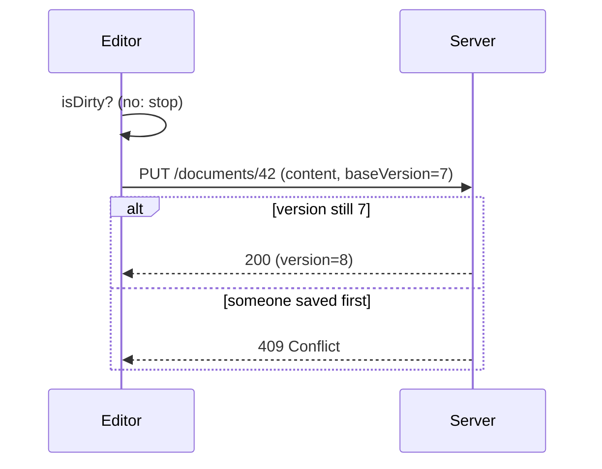

# Worked examples

Three uses of the skill. The same idea at five readers, one show-me answer, and one change explanation. The project names are invented for the examples. In real use, every name comes from the user's code.

## 1. One idea, four readers

The question: "what is a database index?"

### `kid`

> A book has a page at the back called an index. It lists every important word and the page it is on. Without it, you would read the whole book to find one word. A database index is the same list, but for a table. The computer checks the list instead of reading every row. The list has a cost: every time you add a row, the computer also has to add it to the list.

### `new` (default)

> An index is a separate, sorted structure that a database keeps next to a table so it can find rows by one column without scanning every row.
>
> Think of the index at the back of a book: it maps a word to page numbers, so you jump straight there instead of reading cover to cover. The analogy breaks in one place: a book index is built once, but a database index is updated every time a row is inserted, updated, or deleted.
>
> When you query `WHERE email = 'a@b.c'`, the database looks up `a@b.c` in the index, gets the row's location, and reads that one row. Without the index, it reads all 2 million rows. With it, it reads a handful of pages.
>
> So an index makes reads on that column fast and writes on that table slightly slower. Add one for a column you search by often. Do not add one for every column.
>
> An index trades slower writes for faster lookups on one column.

### `peer`

> A B-tree (by default) over one or more columns, stored separately from the heap, with leaf entries pointing at row locations. Equality and range predicates on a leading prefix of the key use it. A predicate on a non-leading column does not.
>
> On `users (email)`, `WHERE email = ?` goes from a sequential scan (O(n) pages) to an index lookup plus one heap fetch (O(log n) pages). Each insert, update of `email`, or delete also writes the index.
>
> Watch for: index-only scans when every selected column is in the index, bloat after heavy updates, and a composite index whose column order does not match the query's leading predicate.

### `boss`

> Adding an index on the `email` column makes the user lookup on the login page go from about 800 milliseconds to under 5 milliseconds at current table size. It costs a one-time build of a few minutes, a small amount of disk, and a slight slowdown on sign-ups, which are rare compared with logins.
>
> Recommendation: add it. No user-facing risk. The one thing to schedule is the build, which should run off-peak because it reads the whole table once.

### `terse`

> Index = sorted copy of one column plus row pointers. Lookup on `email`: index seek, about log n pages, not a full scan. Cost: every insert, update, delete on `users` also writes the index. Add one for columns you filter on often. Not every column.

## 2. Show me: "what happens when I click Save?"

The user asked with "show me", so the answer is visual first. The code is a web editor. The real function names are in the tree.

> Save checks whether anything changed, writes once if it did, and never blocks the editor.

```
onSaveClick()                       editor/toolbar.tsx
├─ draft.isDirty()                  false: return, no network call
├─ api.saveDocument(draft)          api/documents.ts
│  └─ PUT /documents/:id            body: content, baseVersion
│     ├─ 200 → setVersion(new)
│     └─ 409 → showConflict()       someone else saved first
└─ setStatus("saved")               after the response, not before
```

> The 409 branch is the one that surprises people. The server compares `baseVersion` with its current version. If another tab saved in between, the server refuses, and the editor shows a conflict instead of overwriting.

For "how do the browser and server talk during that?", the same answer as a sequence diagram:



## 3. Change: "explain this PR to someone who was not in the session"

The PR moves session lookup from a per-request database read to an in-memory cache with a 60-second lifetime.

> **Problem**
>
> Every API request reads the `sessions` table to check the caller's token. At current traffic that is about 1,200 reads per second on one table, and the p95 latency of every endpoint includes that read, about 12 milliseconds. During the incident on 3 October, that table was the first thing to saturate.
>
> **Solution**
>
> Today: request arrives, middleware reads `sessions` by token, request continues or gets a 401.
>
> After: request arrives, middleware checks an in-process cache keyed by token. On a hit, the request continues with no database read. On a miss, it reads `sessions` as before and stores the row for 60 seconds. A logout deletes the row from the database and also removes the cache entry on the instance that handled the logout.
>
> The session store (the database table) stays the source of truth. The cache is a derived copy that can be up to 60 seconds stale on instances that did not handle the logout.
>
> **What changes**
>
> - Schema: none.
> - API: none. Responses are byte-identical.
> - Config: new `SESSION_CACHE_TTL_SECONDS`, default 60. Set to 0 to disable.
> - Behavior: after logout, a token can still be accepted for up to 60 seconds on instances other than the one that processed the logout. This is intentional and documented in the PR. A revoked token for a security reason should use the existing `revoke-all` path, which now also broadcasts a cache clear.
>
> **What people will notice**
>
> Every endpoint gets about 10 milliseconds faster, and logging out on one device may take up to a minute to take effect on other open tabs.
