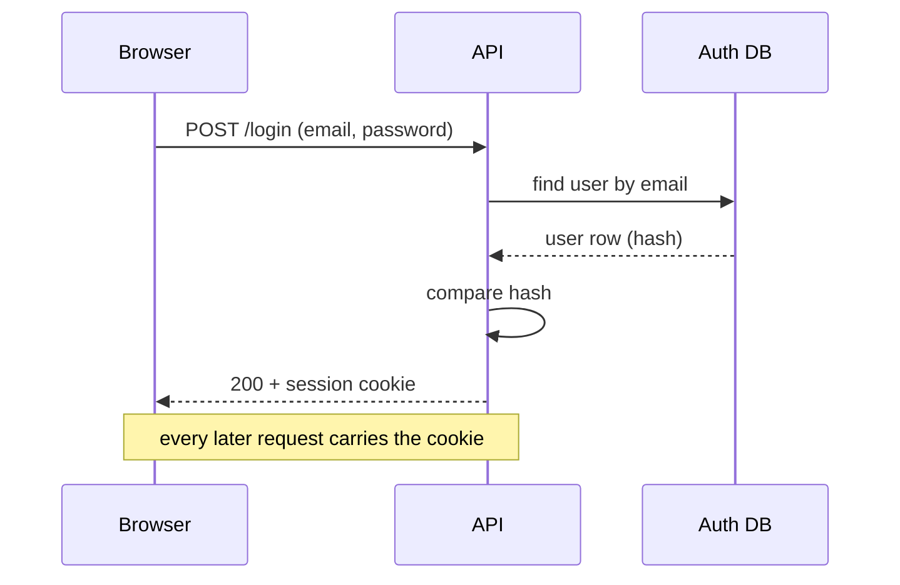
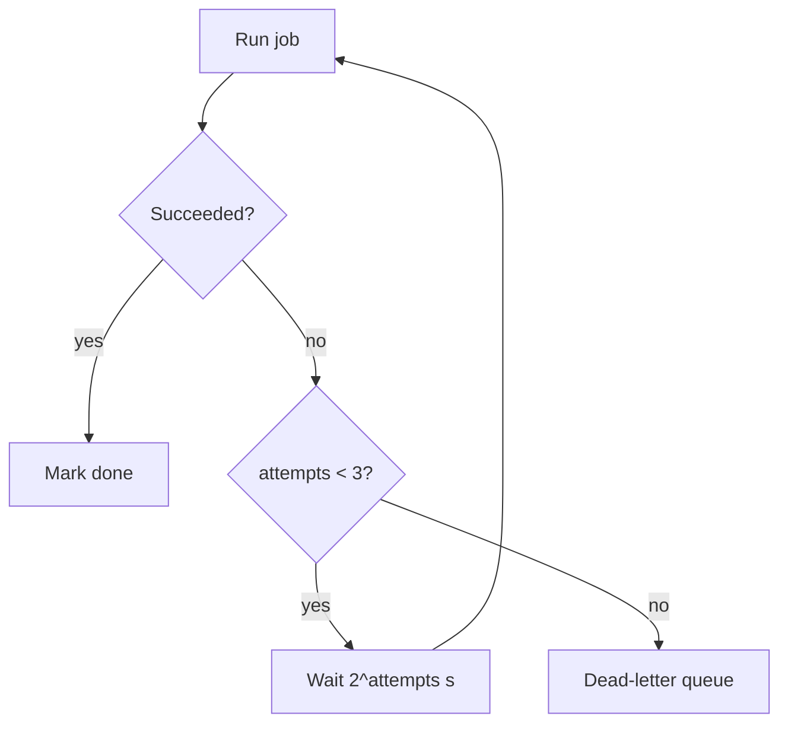

# Forms: a template and an example for each shape

The rule from `SKILL.md`: pick the smallest view that makes the key point clear. One visual is usual. Two is sometimes right. All of them is never right. Every visual sits next to the two or three lines of text it supports, and uses the user's real names.

## 1. Prose

For an idea, a definition, a why. The default when nothing below fits better.

Template: what (one sentence), how (two to four sentences), example (one), so what (one). Drop parts that add nothing for this reader.

> A connection pool is a set of open database connections that your app reuses instead of opening a new one per request. Opening a connection costs a network round trip and a handshake, often 20 to 50 milliseconds. Reusing one costs almost nothing. When a request needs the database, it borrows a connection, runs its query, and returns the connection. If every connection is busy, the request waits. So the pool size caps how many queries run at once. A pool that is too small shows up as slow requests that are not slow in the database.

## 2. Pseudocode

For logic, an algorithm, a branching rule. Strip types, imports, error plumbing, and anything that is not the decision being asked about.

Template:

```
function <name>(<inputs that matter>):
    if <condition the user asked about>:
        return <what happens>
    <the main path, one line per step>
    return <result>
```

Example, for "what does the save handler do when nothing changed?":

```
function save(doc):
    if hash(doc.content) == doc.savedHash:
        return cached result          # no write, no version bump
    version = writeToStore(doc)
    doc.savedHash = hash(doc.content)
    return version
```

Then one line: the early return is why an unchanged doc never gets a new version number.

## 3. Tree

Three kinds. Use ASCII, two-space indent, one line per node, a short comment only where the name does not explain itself.

### Call tree

For what calls what at runtime. Read top to bottom as time.

```
submitForm()                      ui/form.ts
├─ validate()                     returns early on first error
├─ createSession()                api/session.ts
│  └─ POST /sessions
└─ launchAgent(sessionId)         agent/launch.ts
   └─ spawn worker                async, not awaited
```

### Component tree

For UI structure, state ownership, module boundaries. Mark where state lives.

```
<App>
├─ <Sidebar>                      sidebar.tsx
└─ <Editor>                       editor.tsx     owns: draft, dirty
   ├─ <Toolbar>                   reads: dirty
   └─ <Canvas>                    writes: draft
```

### File tree

For which file owns what, or a wide refactor. Keep it shallow: the files that matter for this question, not the whole repo.

```
src/
├─ auth/
│  ├─ session.ts        issues and checks tokens
│  └─ middleware.ts     rejects requests with no valid token
└─ routes/
   └─ login.ts          only route that calls session.issue()
```

## 4. Diagram (Mermaid)

For how parts talk to each other over time, a flow with decisions, or a state machine. Five to twelve nodes. Real names. Check that it renders (paste into a Mermaid preview, or use a render tool if one is installed) before you send it.

| The question is about | Diagram type |
|---|---|
| Who sends what to whom, in what order | `sequenceDiagram` |
| A flow with decisions and branches | `flowchart` |
| The states a thing can be in and what moves it between them | `stateDiagram-v2` |
| Tables and how they relate | `erDiagram` |
| Classes or modules and their relations | `classDiagram` |
| Work over time with dependencies | `gantt` (rare in an explanation) |

Example, for "how does login work end to end?":



Then one line: the password never leaves the API. Only the cookie goes back to the browser.

Example, for "when does a job get retried?":



## 5. Diff

For what changes, when the surrounding shape already exists. The diff takes the same shape as the thing. A component change is a component-tree diff. A file move is a file-tree diff. A new call is a call-tree diff. A new state is a state diff. Use `+` and `-` prefixes, keep unchanged context minimal.

Call-tree diff, for "what will the refactor look like?":

```
submitForm()
├─ validate()
-├─ createSession()
-│  └─ POST /sessions
+├─ getOrCreateSession()          reuses an open session when one exists
+│  └─ GET /sessions/current, then POST only on 404
└─ launchAgent(sessionId)
```

State diff:

```
  Editor state
    draft: string
    dirty: boolean
-   saving: boolean
+   saveState: "idle" | "saving" | "failed"
+   lastError?: string
```

## 6. Code

For mostly-new code, or when the reader needs a copyable target shape. Full code block in the real language, real names, no `// ...` where the omitted part is the point. Keep it to the function or block the question is about.

## 7. HTML page

For a spatial layout, a before/after screen, a walkthrough of a codebase, or an idea too dense for Mermaid. Build it only when the user asks, or when the idea is genuinely spatial.

Checklist:

- One self-contained `.html` file. Inline CSS and JavaScript. No build step. If a library is needed (Mermaid for diagrams), load it from a CDN with a pinned version.
- Big visuals, few words. Each panel makes one point. The text on a panel fits in two sentences.
- Real labels and real data from the user's project. Never lorem ipsum, never `foo`.
- Readable on a phone. Works in light and dark (`prefers-color-scheme`). Keyboard reachable.
- Diagrams as inline SVG or Mermaid. No charting library for a diagram.
- For a codebase walkthrough: a Mermaid flowchart or ER diagram of 5 to 12 concepts. Add a panel per node with a plain description, the file path, and a short code snippet. Explore the code first. Draw second.
- Write the file into the project (for example `explain-<topic>.html`), or into a scratch directory if the project must stay clean. Open it: `open` on macOS, `xdg-open` on Linux, `start` on Windows. If no opener is available, print the path.
- Render it before you deliver it when a headless browser is available. Fix anything broken.
- Print the path and a three-line prose summary of the same content, so the user can skip the page.

## Picking between two forms

- Prose versus pseudocode: if the reader would have to hold more than two conditions in their head, pseudocode.
- Call tree versus sequence diagram: a call tree when one process owns everything. A sequence diagram when two or more parties exchange messages.
- Tree versus diagram: a tree when the shape is a hierarchy. A diagram when there are cycles, branches, or time.
- Diff versus code: a diff when the reader knows the old shape. Code when they do not, or when most of it is new.
- Mermaid versus HTML: Mermaid first. HTML when Mermaid cannot show it, or the user asked for a page.
